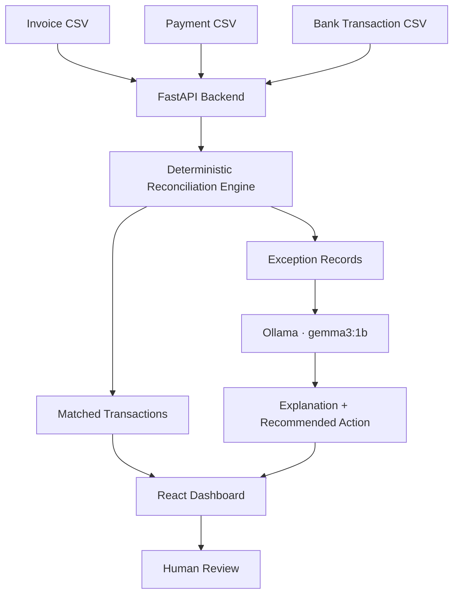

<div align="center">

# 💸 AI Finance Controller

### From scattered financial records to clear, explainable reconciliation.

**A local-first financial reconciliation dashboard powered by FastAPI, React, and Ollama.**

<p>
  
  
  
  
  
</p>

**Reconcile. Investigate. Explain. Review.**

</div>

---

## ✨ The idea

Finance teams often need to compare invoices, payment records, and bank transactions across multiple files. Doing this manually can be slow, repetitive, and prone to missed discrepancies.

**AI Finance Controller** brings these records into one workflow. Its reconciliation engine identifies transaction outcomes, while a local language model helps explain exceptions and suggest investigation steps.

> **Design principle:** deterministic code makes reconciliation decisions; AI assists with explanations. Financial exceptions remain subject to human review.

---

## 🖥️ What it does

| Capability | What it provides |
|---|---|
| 📂 **CSV data input** | Work with invoice, payment, and bank transaction datasets |
| 🔎 **Transaction reconciliation** | Match records and flag discrepancies |
| 🚩 **Exception detection** | Identify missing records, amount mismatches, and duplicate bank transactions |
| 🧠 **AI-assisted explanations** | Use Ollama with `gemma3:1b` to explain exceptions and suggest next steps |
| 📊 **Dashboard metrics** | View match rates, matched records, and exceptions |
| 🧾 **CSV result files** | Inspect reconciliation and exception-analysis output |
| 🛡️ **Human-review workflow** | Keep exception resolution under human oversight |
| 🧪 **Clean test dataset** | Validate the happy path with a synthetic 100-record dataset |

---

## 🧭 How the workflow fits together



### The workflow, in four steps

1. **Load** — select the original datasets, upload supported CSV files, or choose the clean test dataset.
2. **Reconcile** — compare financial records and classify transaction outcomes.
3. **Explain** — ask the local Ollama model to provide context and recommended investigation steps for exceptions.
4. **Review** — use the dashboard and output CSVs to inspect the evidence. AI output is advisory, not an approval or a financial instruction.

---

## 📈 Verified demo scenarios

The following results were observed with the project's current test datasets.

| Scenario | Matched | Exceptions | Match rate |
|---|---:|---:|---:|
| Original dataset | 80 | 20 | 80% |
| Clean synthetic dataset | 100 | 0 | 100% |

### Original dataset: exception mix

| Reconciliation status | Count |
|---|---:|
| `MATCHED` | 80 |
| `MISSING_BANK` | 8 |
| `AMOUNT_MISMATCH` | 7 |
| `DUPLICATE_BANK` | 5 |

*These are results from the current sample datasets, not a claim of production accuracy.*

---

## 🧰 Technology stack

| Layer | Technology |
|---|---|
| Frontend | React + Vite |
| Backend API | FastAPI + Uvicorn |
| AI inference | Ollama |
| Local model | `gemma3:1b` |
| Data exchange | CSV |
| Runtime | Python virtual environment + Node.js/npm |

---

## 🚀 Quick start

### 1. Prerequisites

Install or prepare:

- Python and the project's `.venv` environment
- Node.js and npm
- [Ollama](https://ollama.com/)
- The local model `gemma3:1b`

Check the model:

```powershell
ollama list
```

If it is not installed:

```powershell
ollama pull gemma3:1b
```

### 2. Start everything with one command

From the project root in PowerShell:

```powershell
cd D:\Projects\ai-finance-controller
.\start.ps1
```

The startup script checks Ollama, starts the backend and frontend in separate PowerShell windows when they are not already responding, waits for the services, and attempts to open the dashboard automatically.

If Windows blocks the script, run this in the same PowerShell session and retry:

```powershell
Set-ExecutionPolicy -Scope Process -ExecutionPolicy Bypass
.\start.ps1
```

Keep the backend and frontend terminal windows open while using the application.

### 3. Open the app

| Service | URL |
|---|---|
| Dashboard | [http://localhost:5173](http://localhost:5173) |
| FastAPI Swagger docs | [http://127.0.0.1:8000/docs](http://127.0.0.1:8000/docs) |
| Ollama API | [http://127.0.0.1:11434](http://127.0.0.1:11434) |

---

## 🧪 Demo walkthrough

For a short and repeatable presentation:

1. Start the application with `.\start.ps1`.
2. Open **Original datasets** in the dashboard.
3. Run reconciliation and show the **80 matched / 20 exceptions / 80% match rate** result.
4. Select an exception and inspect its original reconciliation status.
5. Run **Analyze Exceptions with AI** and show the explanation, recommended action, and review status.
6. Select **Clean Test Dataset** and show **100 matched / 0 exceptions / 100% match rate**.
7. Explain the boundary between deterministic reconciliation and AI-assisted investigation.

### Suggested demo message

> “AI Finance Controller automates transaction matching and highlights exceptions. A local language model then helps analysts understand those exceptions and decide what to investigate next, while the original reconciliation result remains authoritative.”

---

## 📁 Project layout

```text
ai-finance-controller/
├── backend/
│   └── app/
│       ├── main.py                 # FastAPI application and API routes
│       ├── agents/
│       │   └── exception_agent.py  # AI-assisted exception analysis
│       └── reconciliation/
│           └── engine.py           # Deterministic reconciliation logic
├── frontend/
│   ├── src/
│   │   └── App.jsx                 # Dashboard UI
│   └── package.json
├── data/
│   ├── uploads/                    # Input CSV files
│   ├── clean_test/                 # Synthetic clean test inputs
│   └── results/                    # Reconciliation and analysis outputs
├── .venv/                          # Python virtual environment (local)
└── start.ps1                       # One-command local startup
```

*This illustrates the current known structure; filenames and folders may differ if you have changed the project since setup.*

---

## 🛡️ Responsible AI and financial safety

- **Reconciliation remains deterministic.** Use the engine's result as the financial matching outcome.
- **AI explanations can be wrong.** Compare generated claims against source invoice, payment, and bank records.
- **Human review is required.** Do not automatically approve, settle, or resolve exceptions based only on an LLM response.
- **Protect financial data.** The local model supports local inference, but files, logs, backups, and network access must also be secured.
- **Validate before production.** Test missing data, duplicate transactions, malformed CSVs, unexpected amounts, and model unavailability.

---

## 🌐 Deployment notes

The current workflow is designed for local development. For a public deployment:

- Host the React frontend and FastAPI backend.
- Configure the frontend API base URL to point to the deployed backend.
- Configure backend CORS for the deployed frontend origin.
- Provide a reachable model inference endpoint; `localhost` on a hosted server does **not** point to your laptop.
- Decide how uploaded files and result CSVs should persist across restarts and redeployments.
- Never expose private financial records or model endpoints without appropriate access controls.

Deployment is a separate step; this README does not imply that a public instance is already live.

---

## 🗺️ Roadmap

- [ ] Validate AI explanations against source amounts and transaction fields
- [ ] Add deterministic exception-priority rules
- [ ] Add automated tests for every reconciliation status
- [ ] Add stronger CSV schema validation and clearer upload errors
- [ ] Add audit logging and secure user access
- [ ] Deploy frontend, backend, and model inference
- [ ] Add persistence and monitoring suitable for production

---

## 🤝 Contributing

1. Create a branch for your change.
2. Make the change and test the affected workflow.
3. Confirm the reconciliation engine remains the source of truth.
4. Submit a pull request with a short description and test evidence.

---

## 📜 License

No license has been specified in this README. Add a license that matches how you intend others to use and distribute the project.

---

<div align="center">

### Built to make financial exceptions easier to understand.

**AI Finance Controller** · Reconciliation with explainable, human-reviewed AI assistance.

</div>
