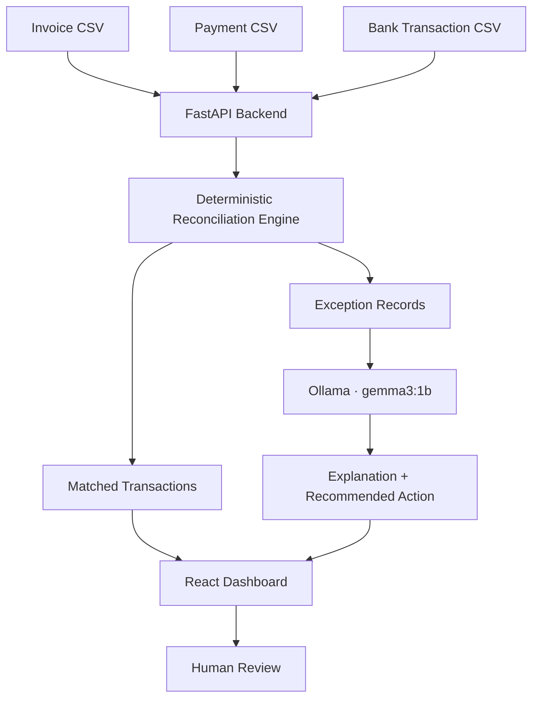

<div align="center">

# 💸 AI Finance Controller

### From scattered financial records to clear, explainable reconciliation.

**A local-first financial reconciliation dashboard powered by FastAPI, React, and Ollama.**

<p>
  
  
  
  
  
</p>

**Reconcile. Investigate. Explain. Review.**

</div>

---

## ✨ The idea

Finance teams often need to compare invoices, payment records, and bank transactions across multiple files. Doing this manually can be slow, repetitive, and prone to missed discrepancies.

**AI Finance Controller** brings these records into one workflow. Its reconciliation engine identifies transaction outcomes, while a local language model helps explain exceptions and suggest investigation steps.

> **Design principle:** deterministic code makes reconciliation decisions; AI assists with explanations. Financial exceptions remain subject to human review.

---

## 🖥️ What it does

| Capability | What it provides |
|---|---|
| 📂 **CSV and PDF data input** | Upload invoice, payment, and bank transaction datasets as CSV files or PDFs |
| 🔎 **Transaction reconciliation** | Match records and flag discrepancies |
| 🚩 **Exception detection** | Identify missing records, amount mismatches, and duplicate bank transactions |
| 🧠 **AI-assisted explanations** | Use Ollama with `gemma3:1b` to explain exceptions and suggest next steps |
| 📊 **Dashboard metrics** | View match rates, matched records, and exceptions |
| 🧾 **CSV result files** | Inspect reconciliation and exception-analysis output |
| 🛡️ **Human-review workflow** | Keep exception resolution under human oversight |
| 🧪 **Clean test dataset** | Validate the happy path with a synthetic 100-record dataset |

---

## 🧭 How the workflow fits together



### The workflow, in four steps

1. **Load** — select the original datasets, upload CSV files or PDFs, or choose the clean test dataset.
2. **Reconcile** — compare financial records and classify transaction outcomes.
3. **Explain** — ask the local Ollama model to provide context and recommended investigation steps for exceptions.
4. **Review** — use the dashboard and output CSVs to inspect the evidence. AI output is advisory, not an approval or a financial instruction.

---

## 📈 Verified demo scenarios

The following results were observed with the project's current test datasets.

| Scenario | Matched | Exceptions | Match rate |
|---|---:|---:|---:|
| Original dataset | 80 | 20 | 80% |
| Clean synthetic dataset | 100 | 0 | 100% |

### Original dataset: exception mix

| Reconciliation status | Count |
|---|---:|
| `MATCHED` | 80 |
| `MISSING_BANK` | 8 |
| `AMOUNT_MISMATCH` | 7 |
| `DUPLICATE_BANK` | 5 |

*These are results from the current sample datasets, not a claim of production accuracy.*

---

## 🧰 Technology stack

| Layer | Technology |
|---|---|
| Frontend | React + Vite |
| Backend API | FastAPI + Uvicorn |
| AI inference | Ollama |
| Local model | `gemma3:1b` |
| Data exchange | CSV |
| Runtime | Python virtual environment + Node.js/npm |

---

## 🚀 Quick start

### 1. Prerequisites

Install or prepare:

- Python and the project's `.venv` environment
- Node.js and npm
- [Ollama](https://ollama.com/)
- The local model `gemma3:1b`

Install the backend dependencies from the project root:

```powershell
.\.venv\Scripts\python.exe -m pip install -r backend\requirements.txt
```

For scanned/image-only PDFs, install Tesseract OCR and make sure `tesseract.exe`
is available on `PATH`. Digitally generated PDFs do not need Tesseract.

Check the model:

```powershell
ollama list
```

If it is not installed:

```powershell
ollama pull gemma3:1b
```

### 2. Start everything with one command

From the project root in PowerShell:

```powershell
cd D:\Projects\ai-finance-controller
.\start.ps1
```

The startup script checks Ollama, starts the backend and frontend in separate PowerShell windows when they are not already responding, waits for the services, and attempts to open the dashboard automatically.

If Windows blocks the script, run this in the same PowerShell session and retry:

```powershell
Set-ExecutionPolicy -Scope Process -ExecutionPolicy Bypass
.\start.ps1
```

Keep the backend and frontend terminal windows open while using the application.

### 3. Open the app

| Service | URL |
|---|---|
| Dashboard | [http://localhost:5173](http://localhost:5173) |
| FastAPI Swagger docs | [http://127.0.0.1:8000/docs](http://127.0.0.1:8000/docs) |
| Ollama API | [http://127.0.0.1:11434](http://127.0.0.1:11434) |

---

## 🧪 Demo walkthrough

For a short and repeatable presentation:

1. Start the application with `.\start.ps1`.
2. Open **Original datasets** in the dashboard.
3. Run reconciliation and show the **80 matched / 20 exceptions / 80% match rate** result.
4. Select an exception and inspect its original reconciliation status.
5. Run **Analyze Exceptions with AI** and show the explanation, recommended action, and review status.
6. Select **Clean Test Dataset** and show **100 matched / 0 exceptions / 100% match rate**.
7. Explain the boundary between deterministic reconciliation and AI-assisted investigation.

To run the backend unit tests:

```powershell
Set-Location backend
python -m unittest discover -s tests -v
```

### Suggested demo message

> “AI Finance Controller automates transaction matching and highlights exceptions. A local language model then helps analysts understand those exceptions and decide what to investigate next, while the original reconciliation result remains authoritative.”

### Uploading CSV and PDF datasets

Choose the dataset type (Invoices, Payments, or Bank Transactions), then upload
one CSV or PDF for that dataset. CSV headers are validated directly. PDFs are
converted to the matching CSV schema using recognizable table headers or
labeled fields; scanned PDFs use local Tesseract OCR. Supported PDF labels
include common variants such as “Invoice Number”, “Paid Amount”, and
“Transaction Reference”. Each upload replaces only that dataset after
extraction and validation succeed.

PDF layouts vary widely. If a bank statement omits transaction IDs, the
extractor assigns page/row-based IDs for reconciliation. Review extracted
values against the source PDF before using the reconciliation results,
especially when OCR was used. If a PDF has no recognizable rows or required
identifiers/amounts, the upload is rejected with an extraction error; upload a
normalized CSV for unsupported layouts.

---

## 📁 Project layout

```text
ai-finance-controller/
├── backend/
│   └── app/
│       ├── main.py                 # FastAPI application and API routes
│       ├── agents/
│       │   └── exception_agent.py  # AI-assisted exception analysis
│       └── reconciliation/
│           └── engine.py           # Deterministic reconciliation logic
├── frontend/
│   ├── src/
│   │   └── App.jsx                 # Dashboard UI
│   └── package.json
├── data/
│   ├── uploads/                    # Input CSV files
│   ├── clean_test/                 # Synthetic clean test inputs
│   └── results/                    # Reconciliation and analysis outputs
├── .venv/                          # Python virtual environment (local)
└── start.ps1                       # One-command local startup
```

*This illustrates the current known structure; filenames and folders may differ if you have changed the project since setup.*

---

## 🛡️ Responsible AI and financial safety

- **Reconciliation remains deterministic.** Use the engine's result as the financial matching outcome.
- **AI explanations can be wrong.** Compare generated claims against source invoice, payment, and bank records.
- **Human review is required.** Do not automatically approve, settle, or resolve exceptions based only on an LLM response.
- **Protect financial data.** The local model supports local inference, but files, logs, backups, and network access must also be secured.
- **Validate before production.** Test missing data, duplicate transactions, malformed CSVs, unexpected amounts, and model unavailability.

---

## 🌐 Deployment notes

The repository includes Vercel configuration for the frontend and a Render
Blueprint for a free Docker-based FastAPI backend. These files prepare the
services for deployment; they do not deploy them automatically.

### Deploy the frontend to Vercel

1. Import this GitHub repository into Vercel.
2. Set **Root Directory** to `frontend` and keep the detected Vite build
   settings.
3. Add the environment variable `VITE_API_BASE_URL` with the public URL of
   your deployed backend, for example `https://your-api.onrender.com`.
4. Deploy or redeploy the frontend, then copy its public URL.

`frontend/vercel.json` configures client-side route fallback. The frontend
uses the local backend URL only during Vite development; production requests
require `VITE_API_BASE_URL`.

### Deploy the backend to Render (free)

1. In Render, create a **Blueprint** from this repository and use the included
   `render.yaml`. The service uses the included `Dockerfile` and free instance
   plan.
2. Set `FRONTEND_ORIGINS` to the exact Vercel origin, such as
   `https://your-app.vercel.app` (no trailing slash).
3. `OLLAMA_URL` is optional. Leave it empty to use rule-based exception
   explanations; if set, it must be a reachable Ollama `/api/generate`
   endpoint. A hosted backend cannot reach Ollama on your laptop through
   `localhost`.
4. After the backend is live, set its URL as Vercel's `VITE_API_BASE_URL` and
   redeploy the frontend.

`backend/.env.example` and `frontend/.env.example` list the relevant settings.
Do not commit real credentials or private endpoint tokens.

### Deployment limitations

- Render's free web services can spin down when idle, so the first request
  after inactivity may take longer.
- The backend currently writes uploads and generated results to local files.
  Those files may be lost when a hosted instance restarts or is redeployed;
  persistent storage or a database is needed for durable user data.
- The app does not currently provide authentication or tenant isolation. Do
  not use a public deployment with private financial data until access
  controls and storage protections are in place.
- AI exception analysis needs an Ollama endpoint reachable by the backend.
  Reconciliation and rule-based analysis can run without that service.

---

## 🗺️ Roadmap

- [ ] Validate AI explanations against source amounts and transaction fields
- [ ] Add deterministic exception-priority rules
- [ ] Extend automated tests to every reconciliation status and PDF layout
- [ ] Add audit logging and secure user access
- [ ] Deploy frontend, backend, and model inference
- [ ] Add persistence and monitoring suitable for production

---

## 🤝 Contributing

1. Create a branch for your change.
2. Make the change and test the affected workflow.
3. Confirm the reconciliation engine remains the source of truth.
4. Submit a pull request with a short description and test evidence.

---

## 📜 License

No license has been specified in this README. Add a license that matches how you intend others to use and distribute the project.

---

<div align="center">

### Built to make financial exceptions easier to understand.

**AI Finance Controller** · Reconciliation with explainable, human-reviewed AI assistance.

</div>
